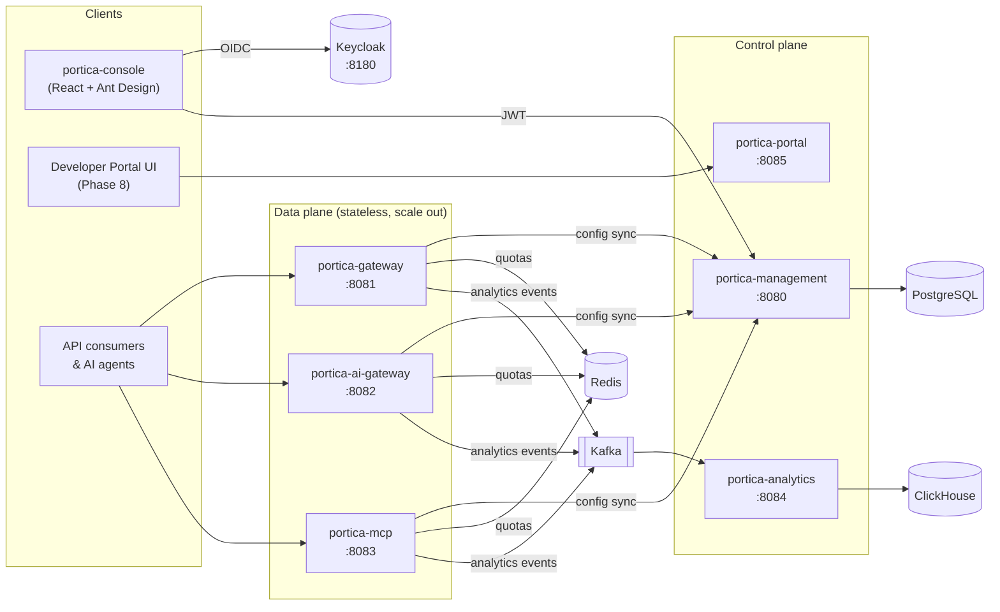
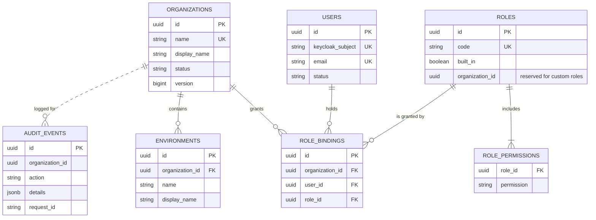
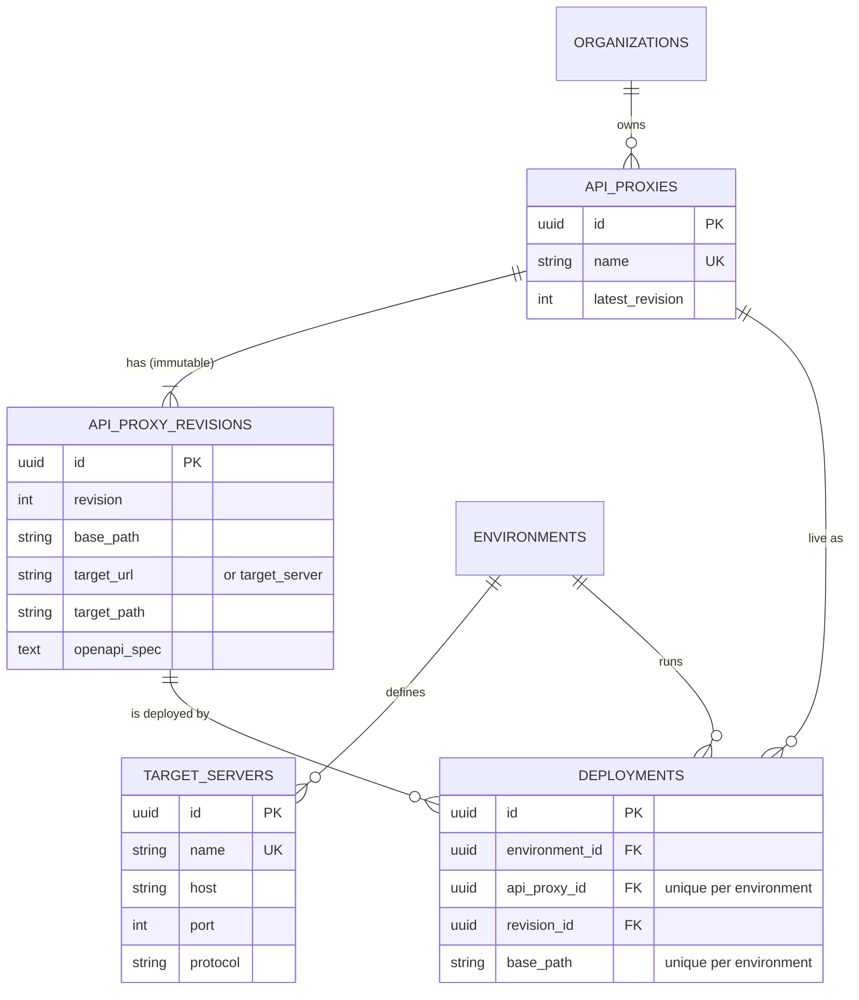
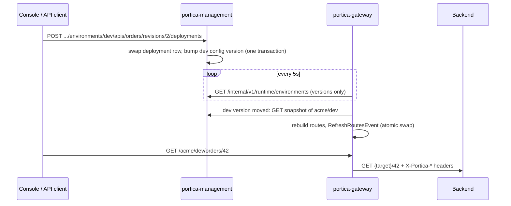
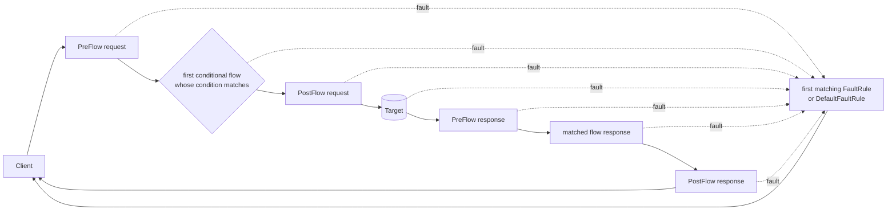
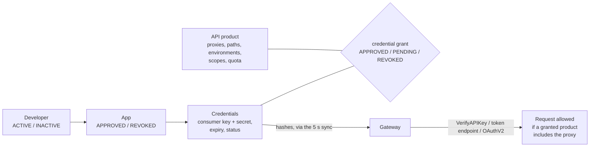

# Portica

**The front door to your APIs.** A self-hosted, cloud-agnostic API management platform:
High-level completeness without the cost or lock-in.

> **Status: Phase 6 – Analytics & Trace.** Organizations, environments, members and RBAC (Phase 1); target
> servers, API proxies with immutable revisions, OpenAPI import and live deployments (Phase 2); a policy
> engine with flows, fault rules, shared flows and 17 built-in policies (Phase 3); API products,
> developers, apps with key issuance, rotation and revocation, key value maps and OAuth 2.0 client
> credentials (Phase 4); a React + Ant Design web console with a drag-and-drop policy flow editor
> (Phase 5); and API analytics (gateway → Kafka → ClickHouse) with ECharts dashboards, an audit log
> page and live trace sessions streamed to the console (Phase 6).

---

## Architecture



### Modules

| Module | Port | Phase 1 state | Becomes |
|---|---|---|---|
| `portica-common` | – | Error model, headers, validation, paging | Shared library |
| `portica-management` | 8080 | **Implemented** | Admin API for everything |
| `portica-gateway` | 8081 | **Implemented**: dynamic routing | + policy engine (Phase 3) |
| `portica-analytics` | 8084 | **Implemented** (Phase 6) | Kafka → ClickHouse ingestion of API events and traces |
| `portica-ai-gateway` | 8082 | Skeleton | LLM gateway (Phase 7) |
| `portica-mcp` | 8083 | Skeleton | MCP gateway (Phase 7) |
| `portica-portal` | 8085 | Skeleton | Developer portal backend (Phase 8) |
| `portica-console` | 5173 | Phase 5 | React + Ant Design web console ([README](portica-console/README.md)) |

### Phase 1 data model



### Phase 2 data model



### How a deployment reaches traffic



---

## Prerequisites

- Java 21+ and Maven 3.9+
- Docker (for local infrastructure and the integration tests)
- `jq` (optional, for the curl walkthrough)

## Run it

```bash
# 1. Start infrastructure (Postgres, Redis, Kafka, ClickHouse, Keycloak with the portica realm)
docker compose up -d

# 2. Build and test everything (integration tests start their own Postgres via Testcontainers)
mvn clean verify

# 3. Run the management API, then (in a second terminal) the gateway
mvn -pl portica-management spring-boot:run
mvn -pl portica-gateway spring-boot:run "-Dspring-boot.run.profiles=local"

# 4. The analytics ingester (in a third terminal; optional, feeds the Analytics page and traces)
mvn -pl portica-analytics spring-boot:run

# 5. The console (in a fourth terminal): open http://localhost:5173 and sign in as admin / admin
cd portica-console && npm install && npm run dev
```

The gateway publishes every call to Kafka (`localhost:9092`) and `portica-analytics` writes them to
ClickHouse (`localhost:8123`); both start with `docker compose up -d`. Without them the gateway serves
traffic as usual: it drops events it can't send (and says so in its log once a minute), and the Analytics
page answers *Analytics data is unavailable*.

The gateway needs Redis (Quota counters, response cache, OAuth tokens), which `docker compose up -d`
starts. The `local` profile adds a development API key (`dev-acme-key-123` for org `acme`) that opens
every proxy of `acme`, handy before you've registered any apps. In IntelliJ, set *Active profiles* to
`local` in the gateway's run configuration.

Encrypted key value maps need an AES-256 key on the management API. `.env.example` has a development
key; for `mvn spring-boot:run`, set it in the terminal (or in IntelliJ's run configuration under
*Environment variables*) before starting the management API:

```powershell
$env:PORTICA_KVM_ENCRYPTION_KEY = "o1r8cXTayN7WvWNLZ8JMcwDzlrd05HPoHb9/reetxkQ="   # PowerShell
```
```bash
export PORTICA_KVM_ENCRYPTION_KEY=o1r8cXTayN7WvWNLZ8JMcwDzlrd05HPoHb9/reetxkQ=   # bash
```

Use your own key anywhere but your laptop (`openssl rand -base64 32`), and keep it: changing it makes
stored encrypted values unreadable.

> **Windows PowerShell:** keep the quotes around `-D` arguments that contain dots. PowerShell splits
> unquoted ones at the first dot, and Maven then fails with "Unknown lifecycle phase". Command Prompt,
> Git Bash and macOS/Linux shells accept them with or without quotes.

> **Upgrading from Phase 1?** Keycloak only imports the realm the first time it starts, so recreate it
> once to get the new `portica-gateway` client: `docker compose up -d --force-recreate keycloak`.
> (Local Keycloak data lives inside the container, so this resets it to the seeded users.)

- API docs: http://localhost:8080/swagger-ui.html
- Health: http://localhost:8080/actuator/health
- Keycloak admin: http://localhost:8180 (admin / admin)

To run the management API and gateway in Docker instead:

```bash
mvn -pl portica-management,portica-gateway,portica-analytics -am package -DskipTests
docker compose --profile app up -d --build
```

### Seeded Keycloak users (local only)

| Username | Password | Realm role |
|---|---|---|
| `admin` | `admin` | `portica-platform-admin` |
| `alice` | `alice` | – |
| `bob` | `bob` | – |

## Try it with curl

```bash
token() {
  curl -s http://localhost:8180/realms/portica/protocol/openid-connect/token \
    -d grant_type=password -d client_id=portica-cli -d username="$1" -d password="$1" | jq -r .access_token
}
ADMIN=$(token admin); ALICE=$(token alice); BOB=$(token bob)
API=http://localhost:8080/api/v1

# Platform admin creates an organization with Alice as its first ORG_ADMIN (dev/test/prod are created too)
curl -s -X POST $API/organizations -H "Authorization: Bearer $ADMIN" -H 'Content-Type: application/json' \
  -d '{"name":"acme","displayName":"Acme Corp","adminEmail":"alice@portica.local"}' | jq

# Alice signs in: invitation linked, memberships and effective permissions returned
curl -s $API/me -H "Authorization: Bearer $ALICE" | jq

# Alice invites Bob as a read-only VIEWER
curl -s -X POST $API/organizations/acme/members -H "Authorization: Bearer $ALICE" \
  -H 'Content-Type: application/json' -d '{"email":"bob@portica.local","roles":["VIEWER"]}' | jq

# Bob can list environments ...
curl -s "$API/organizations/acme/environments?q=pro" -H "Authorization: Bearer $BOB" | jq
# ... but cannot create one (403, RFC 7807 body)
curl -s -X POST $API/organizations/acme/environments -H "Authorization: Bearer $BOB" \
  -H 'Content-Type: application/json' -d '{"name":"staging"}' | jq

# Audit trail
curl -s $API/organizations/acme/audit-events -H "Authorization: Bearer $ALICE" | jq '.items[] | {action, actor, resourceName}'
```

### Phase 2: publish an API through the gateway

The demo backend from docker-compose (`http://localhost:8090`) echoes requests, so you can see exactly
what the gateway sends upstream.

```bash
# Alice creates an API proxy whose revision 1 points at the demo backend
curl -s -X POST $API/organizations/acme/apis -H "Authorization: Bearer $ALICE" -H 'Content-Type: application/json' \
  -d '{"name":"echo","revision":{"basePath":"/echo","target":{"url":"http://localhost:8090/anything"}}}' | jq

# Deploy revision 1 to dev
curl -s -X POST $API/organizations/acme/environments/dev/apis/echo/revisions/1/deployments \
  -H "Authorization: Bearer $ALICE" | jq

# Within ~5 seconds the gateway serves it: /acme/dev/echo/** -> http://localhost:8090/anything/**
curl -s "http://localhost:8081/acme/dev/echo/orders/42?status=open" | jq '{url, headers}'
# The backend sees X-Portica-Org/Env/Proxy/Revision and X-Portica-Request-Id headers.

# Change something = new revision. Deploying it swaps the route in place (no downtime, no restart).
curl -s -X POST $API/organizations/acme/apis/echo/revisions -H "Authorization: Bearer $ALICE" \
  -H 'Content-Type: application/json' -d '{"basePath":"/echo","target":{"url":"http://localhost:8090/anything/v2"}}' | jq
curl -s -X POST $API/organizations/acme/environments/dev/apis/echo/revisions/2/deployments -H "Authorization: Bearer $ALICE" | jq

# Import a real OpenAPI spec (YAML or JSON): creates the proxy, or a new revision if it exists
SPEC=$(curl -s https://petstore3.swagger.io/api/v3/openapi.json)
jq -n --arg spec "$SPEC" '{name:"petstore", spec:$spec}' | \
  curl -s -X POST $API/organizations/acme/apis/import -H "Authorization: Bearer $ALICE" \
  -H 'Content-Type: application/json' -d @- | jq '{createdApiProxy, operationCount, revision: .revision.target}'

# What is the gateway serving right now?
curl -s http://localhost:8081/actuator/gateway/routes | jq '.[].route_id'
```

### Phase 3: protect the API with policies

A revision can carry a policy bundle: `policies` (named, configured instances) and `flows` (where they run).

```bash
# Revision 3 of "echo": CORS, API key, quota per app, header enrichment, a fault rule and JSON->XML on demand
cat > bundle.json <<'EOF'
{"basePath":"/echo","target":{"url":"http://localhost:8090/anything"},
 "policies":[
   {"name":"cors","type":"CORS","config":{"allowOrigins":["http://localhost:3000"],"allowHeaders":["*"]}},
   {"name":"verify-key","type":"VerifyAPIKey","config":{}},
   {"name":"quota","type":"Quota","config":{"count":5,"interval":1,"timeUnit":"minute",
                                             "identifier":"{verifyapikey.verify-key.client_id}"}},
   {"name":"spike","type":"SpikeArrest","config":{"rate":"20ps"}},
   {"name":"enrich","type":"AssignMessage","config":{
      "setHeaders":{"X-App":"{verifyapikey.verify-key.app.name}"},"removeHeaders":["x-api-key"]}},
   {"name":"to-xml","type":"JSONToXML","config":{"rootElement":"response"}},
   {"name":"no-key","type":"RaiseFault","config":{"statusCode":401,"headers":{"WWW-Authenticate":"ApiKey"},
      "body":"{\"error\":\"unauthorized\",\"reason\":\"{fault.name}\"}"}}],
 "flows":{
   "preFlow":{"request":[{"policy":"cors"},{"policy":"spike"},{"policy":"verify-key"},
                         {"policy":"quota"},{"policy":"enrich"}]},
   "conditionalFlows":[{"name":"xml","condition":"request.header.accept == \"application/xml\"",
                        "response":[{"policy":"to-xml"}]}],
   "faultRules":[{"name":"auth","condition":"fault.name == \"InvalidApiKey\" or fault.name == \"FailedToResolveAPIKey\"",
                  "steps":[{"policy":"no-key"}]}]}}
EOF
curl -s -X POST $API/organizations/acme/apis/echo/revisions -H "Authorization: Bearer $ALICE" \
  -H 'Content-Type: application/json' -d @bundle.json | jq '{revision, policies: [.policies[].name]}'
curl -s -X POST $API/organizations/acme/environments/dev/apis/echo/revisions/3/deployments -H "Authorization: Bearer $ALICE" | jq

curl -i http://localhost:8081/acme/dev/echo/pets                                   # 401, reshaped by the fault rule
curl -s http://localhost:8081/acme/dev/echo/pets -H 'x-api-key: dev-acme-key-123' | jq .headers  # X-App: demo-app
curl -s http://localhost:8081/acme/dev/echo/pets -H 'x-api-key: dev-acme-key-123' -H 'Accept: application/xml'
for i in 1 2 3 4 5 6; do curl -s -o /dev/null -w '%{http_code} ' http://localhost:8081/acme/dev/echo/pets \
  -H 'x-api-key: dev-acme-key-123'; done; echo                                       # ... 429 once the quota is used

# Invalid bundles are rejected with every problem listed
curl -s -X POST $API/organizations/acme/apis/echo/revisions -H "Authorization: Bearer $ALICE" -H 'Content-Type: application/json' \
  -d '{"basePath":"/echo","target":{"url":"http://localhost:8090"},"policies":[{"name":"q","type":"Quota","config":{"count":0}}],
       "flows":{"preFlow":{"request":[{"policy":"nope"}]}}}' | jq '{code, errors}'

# Shared flows: reusable chains, deployed per environment, called with FlowCallout
curl -s -X POST $API/organizations/acme/sharedflows -H "Authorization: Bearer $ALICE" -H 'Content-Type: application/json' \
  -d '{"name":"security","revision":{"policies":[{"name":"spike","type":"SpikeArrest","config":{"rate":"50ps"}}],
       "steps":[{"policy":"spike"}]}}' | jq
curl -s -X POST $API/organizations/acme/environments/dev/sharedflows/security/revisions/1/deployments \
  -H "Authorization: Bearer $ALICE" | jq
# then add {"name":"common","type":"FlowCallout","config":{"sharedFlow":"security"}} to any proxy bundle

# The policy catalog (what the console's policy palette will show)
curl -s $API/policy-types -H "Authorization: Bearer $ALICE" | jq '.[] | {type, category}'
```

### Phase 4: publish an API product and let an app call it

```bash
# 1. An API product: which proxies, which environments, scopes, quota
curl -s -X POST $API/organizations/acme/apiproducts -H "Authorization: Bearer $ALICE" -H 'Content-Type: application/json' \
  -d '{"name":"echo-gold","proxies":["echo"],"environments":["dev"],"scopes":["echo.read"],
       "quota":{"count":100,"interval":1,"timeUnit":"minute"}}' | jq

# 2. A developer and an app; the response is the only time you see the consumer secret
curl -s -X POST $API/organizations/acme/developers -H "Authorization: Bearer $ALICE" -H 'Content-Type: application/json' \
  -d '{"email":"ada@example.com","firstName":"Ada","lastName":"Lovelace"}' | jq
APP=$(curl -s -X POST $API/organizations/acme/developers/ada@example.com/apps -H "Authorization: Bearer $ALICE" \
  -H 'Content-Type: application/json' -d '{"name":"mobile","apiProducts":["echo-gold"]}')
KEY=$(echo "$APP" | jq -r .credential.consumerKey); SECRET=$(echo "$APP" | jq -r .credential.consumerSecret)
KEY_ID=$(echo "$APP" | jq -r .credential.id)

# 3. Protect the proxy: OAuthV2 (Portica tokens) + the product's quota, or VerifyAPIKey for plain keys
cat > bundle4.json <<'EOF'
{"basePath":"/echo","target":{"url":"http://localhost:8090/anything"},
 "policies":[
   {"name":"oauth","type":"OAuthV2","config":{"requiredScopes":["echo.read"]}},
   {"name":"quota","type":"Quota","config":{"useProductQuota":true}},
   {"name":"tag","type":"AssignMessage","config":{"setHeaders":{"X-App":"{oauthv2.oauth.app.name}"},
                                                   "removeHeaders":["Authorization"]}}],
 "flows":{"preFlow":{"request":[{"policy":"oauth"},{"policy":"quota"},{"policy":"tag"}]}}}
EOF
REV=$(curl -s -X POST $API/organizations/acme/apis/echo/revisions -H "Authorization: Bearer $ALICE" \
  -H 'Content-Type: application/json' -d @bundle4.json | jq .revision)
curl -s -X POST $API/organizations/acme/environments/dev/apis/echo/revisions/$REV/deployments -H "Authorization: Bearer $ALICE" | jq

# 4. The app gets a token from the gateway (client credentials grant) and calls the API
TOKEN=$(curl -s -u "$KEY:$SECRET" -d grant_type=client_credentials http://localhost:8081/acme/dev/oauth2/token | jq -r .access_token)
curl -s http://localhost:8081/acme/dev/echo/pets -H "Authorization: Bearer $TOKEN" | jq .headers   # X-App: mobile
curl -i http://localhost:8081/acme/dev/echo/pets -H "Authorization: Bearer nope"                 # 401 InvalidAccessToken

# 5. Rotate the key (old one keeps working for an hour), then revoke it; the gateway stops it within ~5 s
curl -s -X POST $API/organizations/acme/developers/ada@example.com/apps/mobile/keys/$KEY_ID/rotate \
  -H "Authorization: Bearer $ALICE" -H 'Content-Type: application/json' -d '{"graceSeconds":3600}' | jq
curl -s -X PATCH $API/organizations/acme/developers/ada@example.com/apps/mobile/keys/$KEY_ID \
  -H "Authorization: Bearer $ALICE" -H 'Content-Type: application/json' -d '{"status":"REVOKED"}' | jq
sleep 6; curl -i http://localhost:8081/acme/dev/echo/pets -H "Authorization: Bearer $TOKEN"     # 401: its key is revoked

# 6. Key value maps: configuration and secrets for policies (encrypted values are never returned)
curl -s -X POST $API/organizations/acme/environments/dev/keyvaluemaps -H "Authorization: Bearer $ALICE" \
  -H 'Content-Type: application/json' -d '{"name":"backend","encrypted":true}' | jq
curl -s -X PUT $API/organizations/acme/environments/dev/keyvaluemaps/backend/entries/api-token \
  -H "Authorization: Bearer $ALICE" -H 'Content-Type: application/json' -d '{"value":"s3cret"}' | jq   # value: *****
# In a bundle: {"name":"secrets","type":"KeyValueMapOperations","config":{"mapName":"backend",
#   "get":[{"key":"api-token","assignTo":"private.backend.token"}]}} then use {private.backend.token}
```

### Phase 6: analytics and a live trace

```bash
# Generate some traffic (with the gateway and portica-analytics running; some calls hit the quota: 429)
for i in $(seq 1 50); do curl -s -o /dev/null http://localhost:8081/acme/dev/echo/pets -H 'x-api-key: dev-acme-key-123'; done

# Numbers for the last hour (from, to, environment and apiProxy are optional filters)
curl -s "$API/organizations/acme/analytics/summary" -H "Authorization: Bearer $ALICE" | jq
curl -s "$API/organizations/acme/analytics/top?dimension=app" -H "Authorization: Bearer $ALICE" | jq
curl -s "$API/organizations/acme/analytics/events?status=errors&limit=10" -H "Authorization: Bearer $ALICE" | jq

# Trace calls that carry X-Debug: on, for 5 minutes
SESSION=$(curl -s -X POST $API/organizations/acme/environments/dev/apis/echo/trace-sessions \
  -H "Authorization: Bearer $ALICE" -H 'Content-Type: application/json' \
  -d '{"filterHeader":"X-Debug","filterValue":"on","durationSeconds":300}' | jq -r .id)
sleep 3; curl -s http://localhost:8081/acme/dev/echo/pets -H 'x-api-key: dev-acme-key-123' -H 'X-Debug: on' > /dev/null
curl -N $API/organizations/acme/trace-sessions/$SESSION/stream -H "Authorization: Bearer $ALICE"   # live (SSE)
curl -s -X DELETE $API/organizations/acme/trace-sessions/$SESSION -H "Authorization: Bearer $ALICE" | jq

# Audit log search
curl -s "$API/organizations/acme/audit-events?q=trace&resourceType=TraceSession" -H "Authorization: Bearer $ALICE" | jq
```

In the console: **Analytics** in the side menu, **Audit Log** under *Administer*, and the **Trace** tab of
an API proxy (pick an environment, *Start trace*, call the proxy, click a call to see each policy step).

On Windows PowerShell, use the token snippet from the IntelliJ guide and `Invoke-RestMethod`, or run the
commands above from Git Bash.

## Policies (Phases 3 and 4)

### How a request flows



- A step is `{"policy": "<name>", "condition": "<optional>"}`; it runs only when its condition is true.
- A policy that answers the request itself (CORS preflight, ResponseCache hit) skips the rest of the
  request flow and the target; the response flow still runs.
- A fault stops the flow. The first FaultRule whose condition matches runs (otherwise the
  DefaultFaultRule), shaping the error response. Without one, clients get
  `{"fault":{"name","message","requestId"}}` with the fault's status. Stack traces are never returned.
- `continueOnError: true` on a policy records its fault in `<policy>.failed` / `<policy>.fault.name`
  and carries on.
- `enabled: false` keeps a policy in the bundle but drops its steps.

### Built-in policies

| Policy | Category | What it does | Faults |
|---|---|---|---|
| `VerifyAPIKey` | Security | Validates an app's consumer key (default from `x-api-key`): approved app, active developer, not expired, and an approved API product that includes this proxy and path. Sets `verifyapikey.<name>.client_id`, `.app.name`, `.app.id`, `.developer.email`, `.apiproduct.name` and the shared app variables | `FailedToResolveAPIKey`, `InvalidApiKey`, `ApiKeyExpired` (401), `NoApiProductMatchFound` (403) |
| `OAuthV2` | Security | `VerifyAccessToken`. Without `jwksUri`: Portica tokens from the gateway's token endpoint, re-checked against the app's credential and products on every call. With `jwksUri`: external JWTs (issuer, audiences). Optional `requiredScopes` | `MissingAccessToken`, `InvalidAccessToken` (401), `InsufficientScope`, `NoApiProductMatchFound` (403), `TokenStoreUnavailable` (503) |
| `VerifyJWT` | Security | Verifies a JWT from any source; RS*/ES* via JWKS or HS* with a shared secret; issuer, audience, subject, claims | `JwtMissing`, `JwtInvalid` (401) |
| `AccessControl` | Security | IP/CIDR allow and deny lists | `AccessDenied` (403) |
| `RegularExpressionProtection` | Threat protection | Blocks requests whose path, query, headers or body match patterns | `ThreatDetected` (400) |
| `JSONThreatProtection` | Threat protection | Limits depth, entries, array size, string and name length, body size | `JsonThreatDetected` (400) |
| `Quota` | Traffic | Fixed-window counts per identifier, **shared by all gateways** (Redis); `RateLimit-*` headers. `useProductQuota: true` takes the limit from the API product that authorized the call, counted per app and product | `QuotaViolation` (429), `QuotaUnavailable` (503) |
| `SpikeArrest` | Traffic | Token-bucket smoothing (`100ps`, `600pm`, with `burst`), per gateway instance | `SpikeArrestViolation` (429) |
| `ResponseCache` | Traffic | Caches GET/HEAD responses in Redis; skips `private`/`no-store`/`Set-Cookie` | – |
| `CORS` | Mediation | Answers preflight requests and adds CORS headers to every response, errors included | – |
| `AssignMessage` | Mediation | Sets/adds/removes headers and query params; sets verb, path, body, status, variables | – |
| `JSONToXML` / `XMLToJSON` | Mediation | Converts request or response bodies (XML parsing is XXE-safe) | `InvalidJSON` / `InvalidXML` |
| `RaiseFault` | Mediation | Raises a custom fault; inside a FaultRule, replaces the error response | configurable |
| `ServiceCallout` | Extension | Calls another HTTP service; exposes `servicecallout.<name>.response.*` | `ServiceCalloutFailed` (502) |
| `FlowCallout` | Extension | Runs a deployed shared flow | its policies' faults |
| `KeyValueMapOperations` | Extension | Reads key value map entries (environment or organization scope) into variables; encrypted maps only into `private.*` variables | – |

`GET /api/v1/policy-types` returns the same catalog with each policy's config fields. Unknown config
fields are rejected, so typos fail at revision creation, not at runtime.

### Conditions and templates

Conditions: `==  !=  =| (starts with)  ~ (wildcard)  ~~ (regex)  <  <=  >  >=`, combined with
`and`/`&&`, `or`/`||`, `not`/`!` and parentheses; `null`, `true`, `false`, numbers and quoted strings.
A bare variable is true when it is set and not `false`/empty. Example:
`request.verb == "GET" and proxy.pathsuffix ~ "/pets/*" and not request.header.x-debug`.

Templates use `{variable}` anywhere a policy takes text (headers, bodies, identifiers). Braces that don't
wrap a variable name, like JSON, stay literal.

Variables: `organization.name`, `environment.name`, `apiproxy.name`, `apiproxy.revision`, `proxy.basepath`,
`proxy.pathsuffix`, `request.verb`, `request.uri`, `request.path`, `request.querystring`,
`request.header.<name>`, `request.queryparam.<name>`, `request.content`, `client.ip`, `messageid`,
`response.status.code`, `response.header.<name>`, `response.content`, `fault.name`, `fault.message`,
`error.status.code`, `current.flow.name`, `system.timestamp`, plus those set by policies. After VerifyAPIKey or
OAuthV2 (Portica tokens): `client_id`, `developer.app.name`, `developer.email`, `apiproduct.name`,
`apiproduct.quota.limit` / `.interval` / `.timeunit` and `apiproduct.attribute.<name>`.

### Shared flows

A shared flow is a named list of steps with its own policies and immutable revisions, deployed per
environment and called with `FlowCallout`. Deployment enforces order: a proxy or shared flow can only be
deployed where every shared flow it calls is live, a shared flow can't be undeployed while something
calls it, and call cycles are refused (the gateway also stops at 5 levels of nesting).

## Products, developers and apps (Phase 4)



- **API products** bundle proxies (optionally only some paths, e.g. `/pets/**`) for some environments
  (none listed means all), with the OAuth scopes apps can request and an optional quota. `approvalType`
  `MANUAL` leaves new grants `PENDING` until an administrator approves them.
- **Developers** are API consumers (not console users), identified by email per organization.
  **Apps** belong to a developer and hold one or more **credentials**: a consumer key and secret, an
  optional expiry, and the products granted to that credential.
- **Issuance:** creating an app issues its first credential; `POST .../apps/{app}/keys` issues more.
  The plain key and secret appear **only in that response** (`Cache-Control: no-store`); Portica stores
  SHA-256 hashes and later shows the first 6 characters of the key.
- **Rotation:** `POST .../keys/{id}/rotate` issues a new credential with the same products and lets the
  old one expire after `graceSeconds` (default 1 day; 0 revokes it at once).
- **Revocation:** revoke a key (`PATCH .../keys/{id}` with `status: REVOKED`), a product grant, the app
  or the developer (`INACTIVE`). Gateways stop honouring it on their next sync, existing access tokens
  included.

### OAuth 2.0 client credentials

Each gateway serves, for every environment it runs:

| Endpoint | |
|---|---|
| `POST /{org}/{env}/oauth2/token` | RFC 6749 client credentials grant. Client authentication with HTTP Basic (`consumerKey:consumerSecret`) or `client_id`/`client_secret` form fields. Optional `scope` (must be within the app's products' scopes; default: all of them). Returns `{access_token, token_type: "Bearer", expires_in, scope}` |
| `POST /{org}/{env}/oauth2/revoke` | RFC 7009 token revocation by the client that owns the token |

Tokens are opaque random strings valid for `portica.gateway.oauth.token-ttl` (default 1 hour), stored as
SHA-256 hashes in Redis, so any gateway instance can verify them. `/oauth2` is reserved: API proxies
can't use it as a base path.

### Key value maps

Named key/value sets per environment or per organization, managed through the API and read by the
`KeyValueMapOperations` policy at runtime. Encrypted maps store values with AES-256-GCM, never return
them from the API (`*****`), and may only be assigned to `private.*` variables. Deploying a proxy or
shared flow checks that the maps it reads exist.

## Management API (v1)

| Method | Path | Permission |
|---|---|---|
| GET | `/me` | authenticated |
| GET | `/roles` | authenticated |
| GET | `/organizations` | authenticated (scoped to memberships; all for platform admin) |
| POST | `/organizations` | platform admin |
| GET / PATCH | `/organizations/{org}` | `ORG_READ` / `ORG_UPDATE` |
| DELETE | `/organizations/{org}` (archive) | platform admin |
| GET | `/organizations/{org}/environments[/{env}]` | `ENV_READ` |
| POST / PATCH / DELETE | `/organizations/{org}/environments[/{env}]` | `ENV_CREATE` / `ENV_UPDATE` / `ENV_DELETE` |
| GET | `/organizations/{org}/members[/{userId}]` | `MEMBER_READ` |
| POST / PUT `/{userId}/roles` / DELETE | `/organizations/{org}/members` | `MEMBER_MANAGE` |
| GET | `/organizations/{org}/audit-events` (`q`, `resourceType`, `from`, `to`), `.../audit-events/resource-types` | `AUDIT_READ` |
| GET | `/organizations/{org}/environments/{env}/target-servers[/{name}]` | `ENV_READ` |
| POST / PUT / DELETE | `/organizations/{org}/environments/{env}/target-servers[/{name}]` | `TARGET_SERVER_WRITE` |
| GET | `/organizations/{org}/apis[/{api}]` | `PROXY_READ` |
| POST / PATCH / DELETE | `/organizations/{org}/apis[/{api}]` | `PROXY_WRITE` |
| POST | `/organizations/{org}/apis/import` (OpenAPI 3.x / Swagger 2.0) | `PROXY_WRITE` |
| GET | `/organizations/{org}/apis/{api}/revisions[/{rev}]`, `.../{rev}/openapi`, `.../{rev}/operations` | `PROXY_READ` |
| POST / DELETE | `/organizations/{org}/apis/{api}/revisions[/{rev}]` | `PROXY_WRITE` |
| POST / DELETE | `/organizations/{org}/environments/{env}/apis/{api}/revisions/{rev}/deployments` | `PROXY_DEPLOY` |
| GET | `/organizations/{org}/environments/{env}/deployments`, `/organizations/{org}/apis/{api}/deployments` | `PROXY_READ` |
| GET | `/organizations/{org}/sharedflows[/{name}]`, `.../{name}/revisions[/{rev}]`, `.../{name}/deployments` | `PROXY_READ` |
| POST / DELETE | `/organizations/{org}/sharedflows[/{name}]`, `.../{name}/revisions[/{rev}]` | `PROXY_WRITE` |
| POST / DELETE | `/organizations/{org}/environments/{env}/sharedflows/{name}/revisions/{rev}/deployments` | `PROXY_DEPLOY` |
| GET | `/organizations/{org}/environments/{env}/sharedflow-deployments` | `PROXY_READ` |
| GET | `/policy-types` (policy catalog with config fields) | authenticated |
| GET | `/organizations/{org}/apiproducts[/{name}]` | `PRODUCT_READ` |
| POST / PUT / DELETE | `/organizations/{org}/apiproducts[/{name}]` | `PRODUCT_WRITE` |
| GET | `/organizations/{org}/developers[/{email}]`, `.../{email}/apps[/{app}]`, `/organizations/{org}/apps` | `DEVELOPER_READ` |
| POST / PATCH / DELETE | `/organizations/{org}/developers[/{email}]`, `.../{email}/apps[/{app}]` | `DEVELOPER_WRITE` |
| GET | `.../apps/{app}/keys/{keyId}` | `DEVELOPER_READ` |
| POST / PATCH / DELETE | `.../apps/{app}/keys[/{keyId}]`, `.../keys/{keyId}/rotate`, `.../keys/{keyId}/apiproducts[/{product}]` | `DEVELOPER_WRITE` |
| GET | `/organizations/{org}[/environments/{env}]/keyvaluemaps[/{map}[/entries[/{key}]]]` | `PROXY_READ` |
| POST / PUT / DELETE | `/organizations/{org}[/environments/{env}]/keyvaluemaps[/{map}[/entries/{key}]]` | `PROXY_WRITE` |
| GET | `/organizations/{org}/analytics/summary`, `/timeseries`, `/top?dimension=`, `/events` | `ANALYTICS_READ` |
| POST / GET | `/organizations/{org}/environments/{env}/apis/{api}/trace-sessions` | `TRACE_RUN` |
| GET / DELETE | `/organizations/{org}/trace-sessions/{id}`, GET `.../transactions`, GET `.../stream` (SSE) | `TRACE_RUN` |
| GET | `/internal/v1/runtime/environments`, `/internal/v1/runtime/organizations/{org}/environments/{env}`, `/internal/v1/runtime/trace-sessions` | `portica-runtime` realm role (gateways) |

List endpoints take `page`, `size` (max 100), `sort` (allow-listed fields) and `q` (case-insensitive search)
and return `{items, page, size, totalElements, totalPages}`. Errors are `application/problem+json` with a stable
`code` and the `requestId` (also returned in the `X-Portica-Request-Id` header).

### Built-in roles

| Permission | ORG_ADMIN | API_ADMIN | OPS_ADMIN | BUSINESS_USER | ANALYST | VIEWER |
|---|:-:|:-:|:-:|:-:|:-:|:-:|
| ORG_READ | ✓ | ✓ | ✓ | ✓ | ✓ | ✓ |
| ORG_UPDATE | ✓ | | | | | |
| ENV_READ | ✓ | ✓ | ✓ | ✓ | ✓ | ✓ |
| ENV_CREATE / UPDATE / DELETE | ✓ | | ✓ | | | |
| TARGET_SERVER_WRITE | ✓ | ✓ | ✓ | | | |
| MEMBER_READ | ✓ | ✓ | ✓ | | | ✓ |
| MEMBER_MANAGE | ✓ | | | | | |
| AUDIT_READ | ✓ | | ✓ | | | |
| PROXY_READ | ✓ | ✓ | ✓ | ✓ | ✓ | ✓ |
| PROXY_WRITE | ✓ | ✓ | | | | |
| PROXY_DEPLOY | ✓ | ✓ | ✓ | | | |
| PRODUCT_READ / DEVELOPER_READ | ✓ | ✓ | | ✓ | ✓ | ✓ |
| PRODUCT_WRITE / DEVELOPER_WRITE | ✓ | ✓ | | ✓ | | |
| ANALYTICS_READ | ✓ | ✓ | ✓ | ✓ | ✓ | |
| TRACE_RUN | ✓ | ✓ | ✓ | | | |
| AI_READ / MCP_READ | ✓ | ✓ | ✓ | | ✓ | ✓ |
| AI_WRITE / MCP_WRITE | ✓ | ✓ | | | | |

Permissions for later phases are defined now so role meaning stays stable as features ship.

---

## Design decisions and trade-offs

**Spring Boot 4.1 instead of 3.x.** Spring Boot 3.5, the last 3.x line, reached open-source end of life on
June 30, 2026. A new product should not start on an unsupported framework, so Portica uses Boot 4.1.x with
Spring Cloud 2025.1.x (Oakwood) and springdoc 3.1.x. Visible consequences: Jackson 3 (`tools.jackson.*`),
Testcontainers 2 artifact names (`testcontainers-postgresql`), and Boot 4's renamed starters
(`spring-boot-starter-webmvc`, `spring-boot-starter-security-oauth2-resource-server`).

**Keycloak authenticates, Portica authorizes.** Keycloak owns identities, passwords, MFA and federation.
Organization membership and roles live in Portica's database, because they are product data (audited,
shown in the console, scoped per organization). The only role read from the token is
`portica-platform-admin`. Trade-off: two places to look when debugging access; in return, tenants don't
need Keycloak admin rights and RBAC works with any OIDC provider later.

**Just-in-time users and invitations.** Users are created on their first authenticated request. Members
can be added by email before they ever sign in (`INVITED`); the invitation is linked only when the token's
email is **verified**, preventing invitation takeover.

**403 for unknown organizations.** Non-admins get 403 (not 404) for organizations they can't access, so
organization names cannot be enumerated.

**Soft-delete organizations.** Archiving keeps data and history, blocks access immediately, and keeps the
name reserved. Hard deletion/purge will be a separate, explicit operation.

**At least one ORG_ADMIN.** Removing or demoting the last admin is rejected (422). The check runs under a
row lock on the organization so concurrent requests can't both pass it.

**Audit in the same transaction.** Each change and its audit event commit together. Audit rows have no
foreign keys, so history survives deletions.

**Metrics and probes are unauthenticated** on the API port for local convenience. In production, expose
actuator on a separate management port or internal network only.

**The `portica-cli` client uses the password grant** purely for local curl testing. It is not part of
OAuth 2.1 and must not be enabled outside a laptop. The console will use Authorization Code + PKCE.

### Phase 2

**Immutable revisions.** A revision is never edited; changing a proxy means creating revision N+1.
What is deployed is always exactly what was reviewed, the audit trail is unambiguous, and rollback is just
deploying the previous revision.

**Zero-downtime swaps.** Each proxy has at most one live revision per environment. Deploying another
revision updates that deployment row in place; the gateway replaces the route atomically, and in-flight
requests complete on the old route.

**Gateway pulls; management never pushes.** Gateways poll a tiny version index (default every 5 s) and
fetch an environment's full snapshot only when its version moves. Gateways stay stateless, scale out with
no registration, and keep serving the last known good config if the management plane is down.
Trade-off: changes take up to one poll interval to reach traffic. A push channel (Kafka/Redis) can cut
that later without changing the contract.

**Concurrent changes in one environment are serialized.** Every runtime-relevant change bumps the
environment's config version, which is also optimistically locked, so racing deploys get a 409 instead
of silently conflicting. The database also enforces one revision per proxy and unique base paths per
environment.

**Path-based routing.** Clients call `/{org}/{env}{basePath}/...`. It works with zero DNS setup, but
exposes organization and environment names in URLs. Hostname-based routing (environment groups with
virtual hosts, like Apigee) is planned for the hardening phase.

**Target servers are resolved by the management plane.** Revisions can name a target server instead of a
URL, so one revision promotes from dev to prod and reaches each environment's backend. Changing a target
server re-routes live traffic on the next sync without redeploying. Gateways only ever see concrete URIs.

**Light OpenAPI reader.** Import reads metadata, servers and operations with Jackson's YAML support
instead of a full OpenAPI toolchain. It rejects documents that aren't OpenAPI 3.x/Swagger 2.0 but does not
validate every schema detail; linting can be added as a policy-like check later.

**Gateway-owned headers can't be spoofed.** The gateway strips client-supplied `X-Portica-Org/Env/Proxy/
Revision` headers and sets its own, so backends can trust them. Inbound authentication (API keys, OAuth,
JWT) arrives with the policy engine in Phase 3, so until then a deployed proxy is publicly callable.

**Not yet restricted: where targets may point.** Any http(s) URL is accepted as a target. Before exposing
API creation to less trusted users, add an allow-list of target hosts/networks to prevent the gateway
being used to reach internal services (SSRF).

### Phase 3

**Policies compile once, run many.** The gateway turns each deployed revision into executable objects
when the environment snapshot arrives (configs bound, conditions parsed, shared flows linked). Requests
never parse JSON config or condition text.

**Fail closed.** A revision that doesn't compile on a gateway (unknown policy type, broken shared flow
reference) is not routed at all, so its URL returns 404 instead of running without its security policies.
The management plane validates bundles first, so this is a safety net for version skew between components.

**Streaming unless a policy needs the body.** The engine works out per revision whether any policy reads
the request body or changes the response body. If none does, the request streams to the target and
response policies (headers, status, CORS, rate-limit headers) run on headers only while the body streams
back. Buffering is capped (`portica.gateway.policy.max-request-body-bytes` / `max-response-body-bytes`, 10 MB
by default) and returns 413 / 502 beyond that.

**Quota is distributed; SpikeArrest is local.** Quota uses one atomic Redis script per request, so limits
hold across any number of gateways. If Redis is down, Quota fails open by default (logs a warning,
lets traffic through); set `failOpen: false` to fail with 503 instead. SpikeArrest smooths bursts on each
gateway instance with no network call, like Apigee's per-message-processor behaviour, so its effective
cluster rate is `rate × replicas`.

**CORS is a per-proxy policy.** WebFlux normally answers browser preflight requests itself before any
gateway filter runs. Portica passes them through to the proxy's flows so each API controls its own CORS.

**Development keys.** The `local` profile's configured keys still work next to developer apps; they
open every proxy of their organization and are meant only for a laptop.

**ServiceCallout can reach any http(s) URL.** As with targets, add an outbound allow-list before letting
less trusted users author bundles (SSRF).

### Phase 4

**Credentials travel with the environment snapshot.** Gateways receive every live credential of the
organization (hashes only) with each environment's configuration, and check keys, tokens and product
grants in memory. There is no call to the management plane on the request path, and gateways keep
working when it is down. Any change to a product, developer, app, credential or organization-scoped key
value map bumps the config version of every environment in the organization, so it reaches traffic
within one sync interval (5 s by default). Expiry is also checked at request time, so a key that expires
between syncs stops immediately. Trade-offs: snapshots grow with the number of credentials (fine for
thousands; very large tenants will want an incremental credential feed later), and bursts of app changes
can make concurrent deployments in that organization retry with a 409.

**Hashes, not keys.** Consumer keys and secrets are 190+ bit random strings, so an unsalted SHA-256 is
enough to make a leaked database or snapshot useless to an attacker, and lets the gateway look keys up
directly. The price is that keys are shown only once; there is no "reveal key" button.

**Opaque tokens, checked against live credentials.** Access tokens are random strings, not JWTs. Every
call looks the token up in Redis and then re-checks its credential against the current snapshot, so
revoking a key, app, product grant or developer also stops tokens already issued. JWT access tokens
from an external authorization server are still supported (`OAuthV2` with `jwksUri`). The token endpoint
has no per-client attempt limit yet, so rate-limit `/*/*/oauth2/*` at your load balancer for now.

**Key value map secrets.** Encrypted maps are encrypted at rest with one AES-256 key from configuration
(each value is bound to its map and key, so values can't be swapped between rows). Gateways receive the
decrypted values over the authenticated runtime feed and keep them in memory only. Values assigned to
`private.*` variables are masked in trace sessions (Phase 6). A KMS-backed key and key rotation are
planned for hardening.

### Phase 6

**Analytics never slow down or fail a call.** The gateway records one event per call after the response
completes and hands it to a bounded in-memory queue; a background thread sends it to Kafka. When Kafka is
slow or down the queue fills and new events are dropped and counted, so traffic is unaffected. Kafka in
between makes ingestion resilient: `portica-analytics` writes to ClickHouse in batches and commits Kafka
offsets only after a successful insert, so a ClickHouse outage delays analytics instead of losing them.
Delivery is at least once; a crash between insert and commit can count a batch twice.

**One table of raw events in ClickHouse.** Every call is a row in `api_events` (kept 90 days), sorted by
organization, environment, proxy and time, and the dashboards aggregate on the fly. That is fast enough
for millions of rows per day per organization; materialized rollups can come later for longer retention.
The schema is created by `portica-analytics` at startup; unknown JSON fields are ignored, so gateways can
add fields before the table has them.

**The query API lives in management, not in portica-analytics.** Dashboards need the same sign-in and
organization permissions (`ANALYTICS_READ`) as everything else, which management already enforces.
Every query is scoped to the caller's organization and a window of at most 31 days, values reach
ClickHouse only as typed query parameters, and breakdown dimensions come from a fixed list.

**Trace sessions are short-lived and opt-in.** A session targets one deployed proxy in one environment,
optionally only calls with a given header value or client IP, runs at most 10 minutes and captures at most
100 calls (3 sessions per proxy and environment at a time). Gateways poll active sessions every 2 seconds,
so there is no cost on the request path when nobody is tracing. Each traced call records every step (ran,
skipped by its condition, faulted, or failed and continued), the target call and the response; captured
calls go through Kafka to ClickHouse and are kept for a day. Authorization, cookie and API key headers,
credential query parameters, `private.*` variables and anything named like a secret, token or password
are masked before they leave the gateway. Bodies are not captured.

**Live updates over Server-Sent Events.** The console reads `.../stream` with `fetch` (EventSource can't
send the bearer token) and reconnects on its own; management polls ClickHouse once a second per open
stream. SSE is plain HTTP, so it passes proxies and load balancers that block WebSockets. Starting and
stopping traces is recorded in the audit log.

## Next: Phase 7

AI gateway and MCP gateway: LLM routing, token quotas and prompt policies; and MCP tool access with the
same products, apps and analytics.
