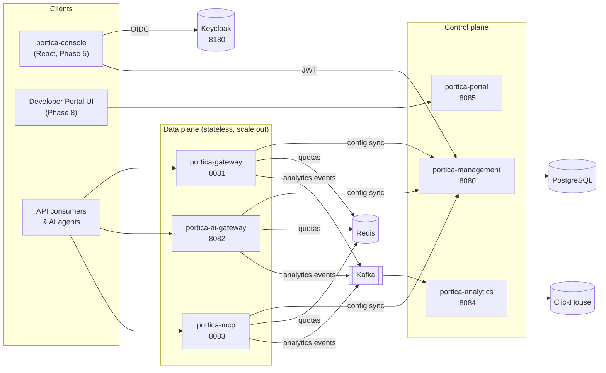
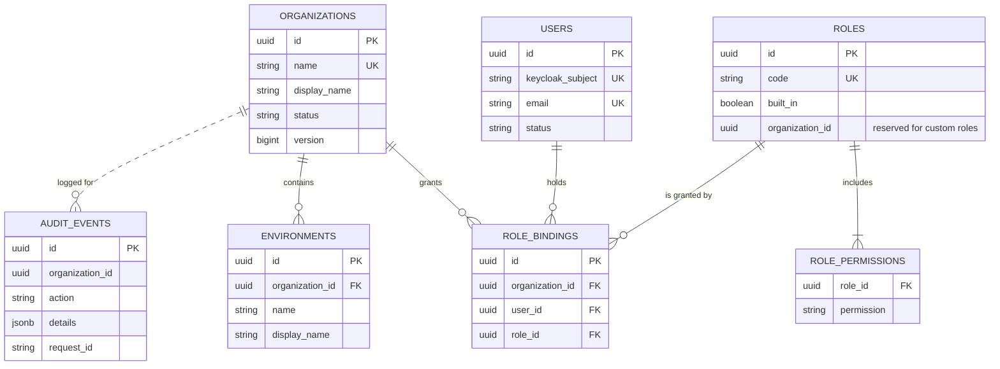
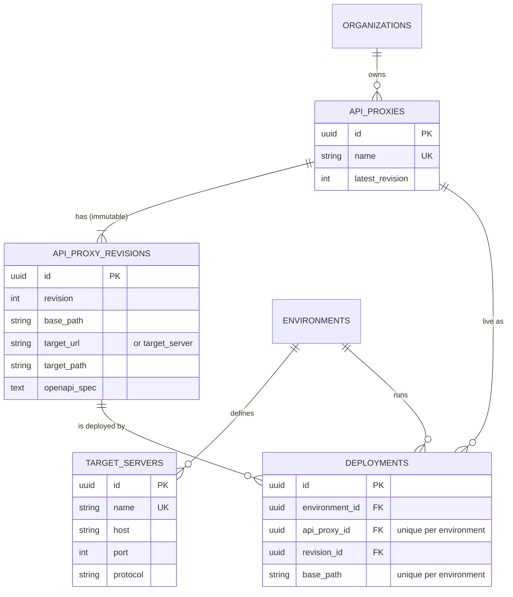
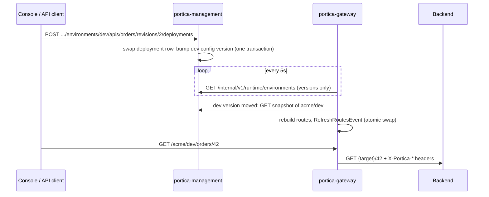

# Portica

**The front door to your APIs.** A self-hosted, cloud-agnostic API management platform:
High-level completeness without the cost or lock-in.

> **Status: Phase 2 – API proxies & gateway core.** Organizations, environments, members and RBAC
> (Phase 1), plus target servers, API proxies with immutable revisions, OpenAPI import,
> deployments, and a gateway that picks up deployment changes live, without restarts.

---

## Architecture



### Modules

| Module | Port | Phase 1 state | Becomes |
|---|---|---|---|
| `portica-common` | – | Error model, headers, validation, paging | Shared library |
| `portica-management` | 8080 | **Implemented** | Admin API for everything |
| `portica-gateway` | 8081 | **Implemented**: dynamic routing | + policy engine (Phase 3) |
| `portica-analytics` | 8084 | Skeleton | Kafka → ClickHouse pipeline + query API (Phase 6) |
| `portica-ai-gateway` | 8082 | Skeleton | LLM gateway (Phase 7) |
| `portica-mcp` | 8083 | Skeleton | MCP gateway (Phase 7) |
| `portica-portal` | 8085 | Skeleton | Developer portal backend (Phase 8) |
| `portica-console` | 5173 | Placeholder | React console (Phase 5) |

### Phase 1 data model



### Phase 2 data model



### How a deployment reaches traffic



---

## Prerequisites

- Java 21+ and Maven 3.9+
- Docker (for local infrastructure and the integration tests)
- `jq` (optional, for the curl walkthrough)

## Run it

```bash
# 1. Start infrastructure (Postgres, Redis, Kafka, ClickHouse, Keycloak with the portica realm)
docker compose up -d

# 2. Build and test everything (integration tests start their own Postgres via Testcontainers)
mvn clean verify

# 3. Run the management API, then (in a second terminal) the gateway
mvn -pl portica-management spring-boot:run
mvn -pl portica-gateway spring-boot:run
```

> **Upgrading from Phase 1?** Keycloak only imports the realm the first time it starts, so recreate it
> once to get the new `portica-gateway` client: `docker compose up -d --force-recreate keycloak`.
> (Local Keycloak data lives inside the container, so this resets it to the seeded users.)

- API docs: http://localhost:8080/swagger-ui.html
- Health: http://localhost:8080/actuator/health
- Keycloak admin: http://localhost:8180 (admin / admin)

To run the management API and gateway in Docker instead:

```bash
mvn -pl portica-management,portica-gateway -am package -DskipTests
docker compose --profile app up -d --build
```

### Seeded Keycloak users (local only)

| Username | Password | Realm role |
|---|---|---|
| `admin` | `admin` | `portica-platform-admin` |
| `alice` | `alice` | – |
| `bob` | `bob` | – |

## Try it with curl

```bash
token() {
  curl -s http://localhost:8180/realms/portica/protocol/openid-connect/token \
    -d grant_type=password -d client_id=portica-cli -d username="$1" -d password="$1" | jq -r .access_token
}
ADMIN=$(token admin); ALICE=$(token alice); BOB=$(token bob)
API=http://localhost:8080/api/v1

# Platform admin creates an organization with Alice as its first ORG_ADMIN (dev/test/prod are created too)
curl -s -X POST $API/organizations -H "Authorization: Bearer $ADMIN" -H 'Content-Type: application/json' \
  -d '{"name":"acme","displayName":"Acme Corp","adminEmail":"alice@portica.local"}' | jq

# Alice signs in: invitation linked, memberships and effective permissions returned
curl -s $API/me -H "Authorization: Bearer $ALICE" | jq

# Alice invites Bob as a read-only VIEWER
curl -s -X POST $API/organizations/acme/members -H "Authorization: Bearer $ALICE" \
  -H 'Content-Type: application/json' -d '{"email":"bob@portica.local","roles":["VIEWER"]}' | jq

# Bob can list environments ...
curl -s "$API/organizations/acme/environments?q=pro" -H "Authorization: Bearer $BOB" | jq
# ... but cannot create one (403, RFC 7807 body)
curl -s -X POST $API/organizations/acme/environments -H "Authorization: Bearer $BOB" \
  -H 'Content-Type: application/json' -d '{"name":"staging"}' | jq

# Audit trail
curl -s $API/organizations/acme/audit-events -H "Authorization: Bearer $ALICE" | jq '.items[] | {action, actor, resourceName}'
```

### Phase 2: publish an API through the gateway

The demo backend from docker-compose (`http://localhost:8090`) echoes requests, so you can see exactly
what the gateway sends upstream.

```bash
# Alice creates an API proxy whose revision 1 points at the demo backend
curl -s -X POST $API/organizations/acme/apis -H "Authorization: Bearer $ALICE" -H 'Content-Type: application/json' \
  -d '{"name":"echo","revision":{"basePath":"/echo","target":{"url":"http://localhost:8090/anything"}}}' | jq

# Deploy revision 1 to dev
curl -s -X POST $API/organizations/acme/environments/dev/apis/echo/revisions/1/deployments \
  -H "Authorization: Bearer $ALICE" | jq

# Within ~5 seconds the gateway serves it: /acme/dev/echo/** -> http://localhost:8090/anything/**
curl -s "http://localhost:8081/acme/dev/echo/orders/42?status=open" | jq '{url, headers}'
# The backend sees X-Portica-Org/Env/Proxy/Revision and X-Portica-Request-Id headers.

# Change something = new revision. Deploying it swaps the route in place (no downtime, no restart).
curl -s -X POST $API/organizations/acme/apis/echo/revisions -H "Authorization: Bearer $ALICE" \
  -H 'Content-Type: application/json' -d '{"basePath":"/echo","target":{"url":"http://localhost:8090/anything/v2"}}' | jq
curl -s -X POST $API/organizations/acme/environments/dev/apis/echo/revisions/2/deployments -H "Authorization: Bearer $ALICE" | jq

# Import a real OpenAPI spec (YAML or JSON): creates the proxy, or a new revision if it exists
SPEC=$(curl -s https://petstore3.swagger.io/api/v3/openapi.json)
jq -n --arg spec "$SPEC" '{name:"petstore", spec:$spec}' | \
  curl -s -X POST $API/organizations/acme/apis/import -H "Authorization: Bearer $ALICE" \
  -H 'Content-Type: application/json' -d @- | jq '{createdApiProxy, operationCount, revision: .revision.target}'

# What is the gateway serving right now?
curl -s http://localhost:8081/actuator/gateway/routes | jq '.[].route_id'
```

On Windows PowerShell, use the token snippet from the IntelliJ guide and `Invoke-RestMethod`, or run the
commands above from Git Bash.

## Management API (v1)

| Method | Path | Permission |
|---|---|---|
| GET | `/me` | authenticated |
| GET | `/roles` | authenticated |
| GET | `/organizations` | authenticated (scoped to memberships; all for platform admin) |
| POST | `/organizations` | platform admin |
| GET / PATCH | `/organizations/{org}` | `ORG_READ` / `ORG_UPDATE` |
| DELETE | `/organizations/{org}` (archive) | platform admin |
| GET | `/organizations/{org}/environments[/{env}]` | `ENV_READ` |
| POST / PATCH / DELETE | `/organizations/{org}/environments[/{env}]` | `ENV_CREATE` / `ENV_UPDATE` / `ENV_DELETE` |
| GET | `/organizations/{org}/members[/{userId}]` | `MEMBER_READ` |
| POST / PUT `/{userId}/roles` / DELETE | `/organizations/{org}/members` | `MEMBER_MANAGE` |
| GET | `/organizations/{org}/audit-events` | `AUDIT_READ` |
| GET | `/organizations/{org}/environments/{env}/target-servers[/{name}]` | `ENV_READ` |
| POST / PUT / DELETE | `/organizations/{org}/environments/{env}/target-servers[/{name}]` | `TARGET_SERVER_WRITE` |
| GET | `/organizations/{org}/apis[/{api}]` | `PROXY_READ` |
| POST / PATCH / DELETE | `/organizations/{org}/apis[/{api}]` | `PROXY_WRITE` |
| POST | `/organizations/{org}/apis/import` (OpenAPI 3.x / Swagger 2.0) | `PROXY_WRITE` |
| GET | `/organizations/{org}/apis/{api}/revisions[/{rev}]`, `.../{rev}/openapi`, `.../{rev}/operations` | `PROXY_READ` |
| POST / DELETE | `/organizations/{org}/apis/{api}/revisions[/{rev}]` | `PROXY_WRITE` |
| POST / DELETE | `/organizations/{org}/environments/{env}/apis/{api}/revisions/{rev}/deployments` | `PROXY_DEPLOY` |
| GET | `/organizations/{org}/environments/{env}/deployments`, `/organizations/{org}/apis/{api}/deployments` | `PROXY_READ` |
| GET | `/internal/v1/runtime/environments`, `/internal/v1/runtime/organizations/{org}/environments/{env}` | `portica-runtime` realm role (gateways) |

List endpoints take `page`, `size` (max 100), `sort` (allow-listed fields) and `q` (case-insensitive search)
and return `{items, page, size, totalElements, totalPages}`. Errors are `application/problem+json` with a stable
`code` and the `requestId` (also returned in the `X-Portica-Request-Id` header).

### Built-in roles

| Permission | ORG_ADMIN | API_ADMIN | OPS_ADMIN | BUSINESS_USER | ANALYST | VIEWER |
|---|:-:|:-:|:-:|:-:|:-:|:-:|
| ORG_READ | ✓ | ✓ | ✓ | ✓ | ✓ | ✓ |
| ORG_UPDATE | ✓ | | | | | |
| ENV_READ | ✓ | ✓ | ✓ | ✓ | ✓ | ✓ |
| ENV_CREATE / UPDATE / DELETE | ✓ | | ✓ | | | |
| TARGET_SERVER_WRITE | ✓ | ✓ | ✓ | | | |
| MEMBER_READ | ✓ | ✓ | ✓ | | | ✓ |
| MEMBER_MANAGE | ✓ | | | | | |
| AUDIT_READ | ✓ | | ✓ | | | |
| PROXY_READ | ✓ | ✓ | ✓ | ✓ | ✓ | ✓ |
| PROXY_WRITE | ✓ | ✓ | | | | |
| PROXY_DEPLOY | ✓ | ✓ | ✓ | | | |
| PRODUCT_READ / DEVELOPER_READ | ✓ | ✓ | | ✓ | ✓ | ✓ |
| PRODUCT_WRITE / DEVELOPER_WRITE | ✓ | ✓ | | ✓ | | |
| ANALYTICS_READ | ✓ | ✓ | ✓ | ✓ | ✓ | |
| TRACE_RUN | ✓ | ✓ | ✓ | | | |
| AI_READ / MCP_READ | ✓ | ✓ | ✓ | | ✓ | ✓ |
| AI_WRITE / MCP_WRITE | ✓ | ✓ | | | | |

Permissions for later phases are defined now so role meaning stays stable as features ship.

---

## Design decisions and trade-offs

**Spring Boot 4.1 instead of 3.x.** Spring Boot 3.5, the last 3.x line, reached open-source end of life on
June 30, 2026. A new product should not start on an unsupported framework, so Portica uses Boot 4.1.x with
Spring Cloud 2025.1.x (Oakwood) and springdoc 3.1.x. Visible consequences: Jackson 3 (`tools.jackson.*`),
Testcontainers 2 artifact names (`testcontainers-postgresql`), and Boot 4's renamed starters
(`spring-boot-starter-webmvc`, `spring-boot-starter-security-oauth2-resource-server`).

**Keycloak authenticates, Portica authorizes.** Keycloak owns identities, passwords, MFA and federation.
Organization membership and roles live in Portica's database, because they are product data (audited,
shown in the console, scoped per organization). The only role read from the token is
`portica-platform-admin`. Trade-off: two places to look when debugging access; in return, tenants don't
need Keycloak admin rights and RBAC works with any OIDC provider later.

**Just-in-time users and invitations.** Users are created on their first authenticated request. Members
can be added by email before they ever sign in (`INVITED`); the invitation is linked only when the token's
email is **verified**, preventing invitation takeover.

**403 for unknown organizations.** Non-admins get 403 (not 404) for organizations they can't access, so
organization names cannot be enumerated.

**Soft-delete organizations.** Archiving keeps data and history, blocks access immediately, and keeps the
name reserved. Hard deletion/purge will be a separate, explicit operation.

**At least one ORG_ADMIN.** Removing or demoting the last admin is rejected (422). The check runs under a
row lock on the organization so concurrent requests can't both pass it.

**Audit in the same transaction.** Each change and its audit event commit together. Audit rows have no
foreign keys, so history survives deletions.

**Metrics and probes are unauthenticated** on the API port for local convenience. In production, expose
actuator on a separate management port or internal network only.

**The `portica-cli` client uses the password grant** purely for local curl testing. It is not part of
OAuth 2.1 and must not be enabled outside a laptop. The console will use Authorization Code + PKCE.

### Phase 2

**Immutable revisions.** A revision is never edited; changing a proxy means creating revision N+1.
What is deployed is always exactly what was reviewed, the audit trail is unambiguous, and rollback is just
deploying the previous revision.

**Zero-downtime swaps.** Each proxy has at most one live revision per environment. Deploying another
revision updates that deployment row in place; the gateway replaces the route atomically, and in-flight
requests complete on the old route.

**Gateway pulls; management never pushes.** Gateways poll a tiny version index (default every 5 s) and
fetch an environment's full snapshot only when its version moves. Gateways stay stateless, scale out with
no registration, and keep serving the last known good config if the management plane is down.
Trade-off: changes take up to one poll interval to reach traffic. A push channel (Kafka/Redis) can cut
that later without changing the contract.

**Concurrent changes in one environment are serialized.** Every runtime-relevant change bumps the
environment's config version, which is also optimistically locked, so racing deploys get a 409 instead
of silently conflicting. The database also enforces one revision per proxy and unique base paths per
environment.

**Path-based routing.** Clients call `/{org}/{env}{basePath}/...`. It works with zero DNS setup, but
exposes organization and environment names in URLs. Hostname-based routing (environment groups with
virtual hosts, like Apigee) is planned for the hardening phase.

**Target servers are resolved by the management plane.** Revisions can name a target server instead of a
URL, so one revision promotes from dev to prod and reaches each environment's backend. Changing a target
server re-routes live traffic on the next sync without redeploying. Gateways only ever see concrete URIs.

**Light OpenAPI reader.** Import reads metadata, servers and operations with Jackson's YAML support
instead of a full OpenAPI toolchain. It rejects documents that aren't OpenAPI 3.x/Swagger 2.0 but does not
validate every schema detail; linting can be added as a policy-like check later.

**Gateway-owned headers can't be spoofed.** The gateway strips client-supplied `X-Portica-Org/Env/Proxy/
Revision` headers and sets its own, so backends can trust them. Inbound authentication (API keys, OAuth,
JWT) arrives with the policy engine in Phase 3, so until then a deployed proxy is publicly callable.

**Not yet restricted: where targets may point.** Any http(s) URL is accepted as a target. Before exposing
API creation to less trusted users, add an allow-list of target hosts/networks to prevent the gateway
being used to reach internal services (SSRF).

## Next: Phase 3

The policy engine: a Policy SPI, PreFlow / conditional flows / PostFlow / FaultRules, shared flows,
and the first policies (VerifyAPIKey, Quota and SpikeArrest on Redis, CORS, AssignMessage), enforced
by the gateway on every deployed revision.
